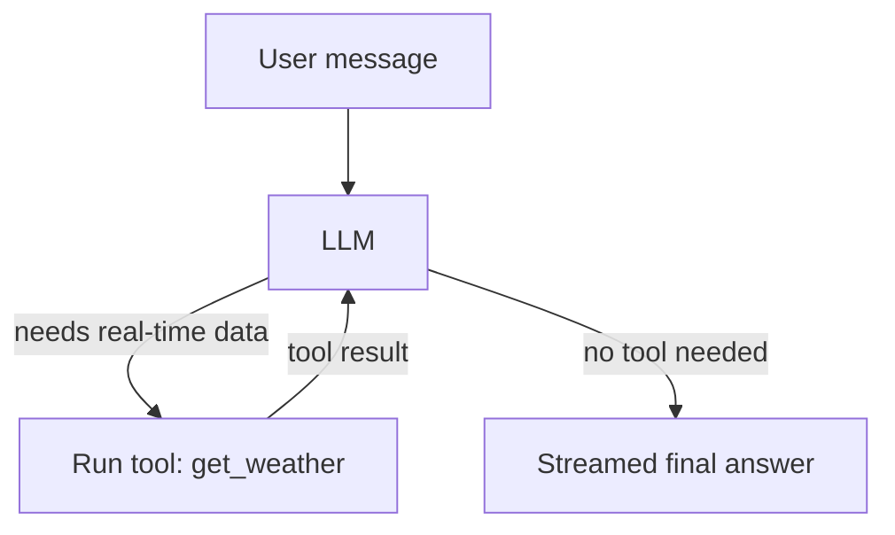

# QueryBot

A streaming AI chat assistant built with **Python, Streamlit and the OpenAI API**. It can answer general questions and, when needed, **decide on its own to call a real-time weather tool** through a multi-step agent loop. It also includes production-style error handling, cost controls and environment-based configuration.

🔗 **Live demo:** [add your Streamlit app link here](https://ai-queryboat.streamlit.app/)


<!-- Add a screenshot named screenshot.png to the repo root (ideally a weather question showing the tool step), or remove this line -->

## Features

- **Tool-calling agent:** the LLM decides when to call the `get_weather` tool for real-time weather (via the free Open-Meteo API) and when to answer directly
- **Multi-step agent loop:** think, call a tool, observe the result, repeat until the answer is ready, with a configurable step limit
- **Real-time streaming** of responses (typing effect), including responses that follow a tool call
- **Visible tool steps:** each tool call is shown above the answer so users can see what the agent did
- **Multi-turn conversation memory** kept in Streamlit session state
- **Robust error handling** with user-friendly messages for invalid API key, rate limit or quota, timeout, connection failure, invalid request and OpenAI server errors
- **Safe tool execution:** a failing or unknown tool returns an error to the model instead of crashing the app
- **Partial response preservation** if a stream fails midway, and clean history after a failed request so the user can retry
- **Cost and abuse controls:** output token limit, input length limit, trimmed chat history and a maximum number of agent steps
- **Timeout and automatic retries** (30 s timeout, 2 retries on transient errors such as timeouts, 429 and 5xx)
- **Configurable via environment variables**, with no hardcoded settings
- **Logging** of errors (user messages are intentionally not logged, for privacy)
- **Clear chat** button in the sidebar

## How the agent works



1. The user's message and the list of available tools are sent to the model.
2. If the model needs real-time data, it requests a tool call (for example `get_weather` with `{"city": "Noida"}`).
3. The app runs the tool and sends the result back to the model.
4. The loop repeats until the model answers without requesting a tool, or until `MAX_AGENT_STEPS` is reached.
5. The final answer is streamed to the user.

The model never runs tools itself. It only requests them, and the application decides what actually runs.

## Example prompts

| Prompt | What happens |
|---|---|
| `What is the temperature in Noida right now?` | The agent calls `get_weather`, then streams the answer |
| `Compare the weather in Delhi and Mumbai` | The agent makes multiple tool calls, then compares |
| `What is Python?` | No tool is used, the answer is streamed directly |
| `What is HTTP? And what is the weather in Delhi?` | General answer plus a tool call in a single response |

## Tech stack

| Area | Tools |
|---|---|
| Language | Python 3.9+ |
| UI | Streamlit |
| LLM | OpenAI API (`gpt-4o-mini` by default), function/tool calling |
| Weather data | Open-Meteo API (free, no API key required) |
| HTTP client | requests |
| Config | python-dotenv, Streamlit Secrets |
| Hosting | Streamlit Community Cloud |

## Getting started

### 1. Clone the repository

```bash
git clone https://github.com/vijay85-tech/ai-queryBoat.git
cd ai-queryBoat
```

### 2. Create and activate a virtual environment

```bash
python -m venv .venv

# Windows
.venv\Scripts\activate

# macOS / Linux
source .venv/bin/activate
```

### 3. Install dependencies

```bash
pip install -r requirements.txt
```

`requirements.txt` should contain:

```
streamlit
openai
python-dotenv
requests
```

### 4. Add your API key

Create a `.env` file in the project root:

```
OPENAI_API_KEY=your-key-here
```

> Never commit `.env`. It is already listed in `.gitignore`.

### 5. Run the app

```bash
streamlit run app.py
```

The app opens at `http://localhost:8501`.

## Configuration

All settings are read from environment variables. Only `OPENAI_API_KEY` is required.

| Variable | Default | Description |
|---|---|---|
| `OPENAI_API_KEY` | none (required) | Your OpenAI API key |
| `MODEL_NAME` | `gpt-4o-mini` | Model used for chat |
| `SYSTEM_PROMPT` | general assistant that uses the weather tool when needed | Sets the assistant's behaviour |
| `TEMPERATURE` | `0.3` | Randomness of the output (0 = stable, higher = more creative) |
| `MAX_OUTPUT_TOKENS` | `1500` | Maximum length of each model reply |
| `MAX_HISTORY_MESSAGES` | `20` | Number of recent messages sent to the model |
| `MAX_INPUT_CHARS` | `4000` | Maximum characters per user message |
| `REQUEST_TIMEOUT` | `30` | Request timeout in seconds |
| `MAX_AGENT_STEPS` | `5` | Maximum tool-calling steps per question |

## Adding a new tool

1. Write a normal Python function that returns a dictionary (for example `get_restaurants(city)`).
2. Describe it in the `TOOLS` list: name, description and parameters.
3. Register it in `AVAILABLE_TOOLS` with the same name.

The model chooses tools based on their descriptions, so keep them clear and specific.

## Deploy on Streamlit Community Cloud

1. Push this repository to GitHub.
2. Go to [share.streamlit.io](https://share.streamlit.io) and sign in with GitHub.
3. Choose **Create app**, select this repo, branch `main` and main file `app.py`.
4. In **Advanced settings**, pick Python 3.11 and add your key under **Secrets**:

   ```toml
   OPENAI_API_KEY = "your-key-here"
   ```

5. Click **Deploy**. Every `git push` to `main` redeploys the app automatically.

## Project structure

```
.
├── app.py              # Streamlit app: UI, streaming, agent loop, tools, error handling
├── requirements.txt    # Python dependencies
├── .gitignore
└── README.md
```

## Security and cost notes

- API keys are loaded from environment variables or Streamlit Secrets, never from source code.
- Set a monthly usage limit in the OpenAI dashboard and keep auto-recharge off, especially for public demos.
- Input length, output tokens, history size and agent steps are capped to keep usage predictable.
- Only the final user and assistant messages are stored in session history. Intermediate tool messages are discarded after each request.

## Limitations

- Only one tool (`get_weather`) is available at the moment.
- Chat history lives in the browser session and is lost on refresh.
- Weather data comes from a free public API and may be unavailable or rate-limited at times.

## Roadmap

- [x] Streaming responses
- [x] Tool calling with a multi-step agent loop
- [ ] More tools (for example restaurant lookup or web search)
- [ ] Retrieval-Augmented Generation (RAG) over custom documents
- [ ] Structured (JSON) outputs with Pydantic
- [ ] React frontend with a FastAPI backend
- [ ] Deployment on Azure

## Author

**[Vijay Gautam]**: [GitHub](https://github.com/vijay85-tech)