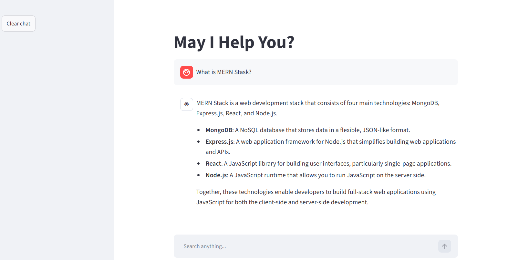

# AI QueryBoat

A streaming AI chat assistant built with **Python, Streamlit and the OpenAI API**, with production-style error handling, cost controls and environment-based configuration.

🔗 **Live demo:** [add your Streamlit app link here](https://ai-queryboat.streamlit.app/)


<!-- Add a screenshot named screenshot.png to the repo root, or remove this line -->

## Features

- **Real-time streaming** responses (typing effect) using the OpenAI Chat Completions API
- **Multi-turn conversation memory** kept in Streamlit session state
- **Robust error handling** with user-friendly messages for:
  - invalid or expired API key
  - rate limit / quota exhausted
  - request timeout
  - connection failure
  - invalid request and OpenAI server errors
- **Partial response preservation** if a stream fails midway, and clean history on failed requests so the user can retry
- **Cost and abuse controls:** output token limit, input length limit and trimmed chat history
- **Timeout and automatic retries** (30 s timeout, 2 retries on transient errors such as timeouts, 429 and 5xx)
- **Configurable via environment variables**, with no hardcoded settings
- **Logging** of errors (user messages are intentionally not logged, for privacy)
- **Clear chat** button in the sidebar

## Tech stack

| Area | Tools |
|---|---|
| Language | Python 3.10+ |
| UI | Streamlit |
| LLM | OpenAI API (`gpt-4o-mini` by default) |
| Config | python-dotenv, Streamlit Secrets |
| Hosting | Streamlit Community Cloud |

## Getting started

### 1. Clone the repository

```bash
git clone https://github.com/vijay85-tech/ai-queryBoat.git
cd ai-queryBoat
```

### 2. Create and activate a virtual environment

```bash
python -m venv .venv

# Windows
.venv\Scripts\activate

# macOS / Linux
source .venv/bin/activate
```

### 3. Install dependencies

```bash
pip install -r requirements.txt
```

### 4. Add your API key

Create a `.env` file in the project root:

```
OPENAI_API_KEY=your-key-here
```

> Never commit `.env`. It is already listed in `.gitignore`.

### 5. Run the app

```bash
streamlit run app.py
```

The app opens at `http://localhost:8501`.

## Configuration

All settings are read from environment variables. Only `OPENAI_API_KEY` is required.

| Variable | Default | Description |
|---|---|---|
| `OPENAI_API_KEY` | none (required) | Your OpenAI API key |
| `MODEL_NAME` | `gpt-4o-mini` | Model used for chat |
| `SYSTEM_PROMPT` | helpful, brief assistant | Sets the assistant's behaviour |
| `TEMPERATURE` | `0.3` | Randomness of the output (0 = stable, higher = more creative) |
| `MAX_OUTPUT_TOKENS` | `800` | Maximum length of each reply |
| `MAX_HISTORY_MESSAGES` | `20` | Number of recent messages sent to the model |
| `MAX_INPUT_CHARS` | `4000` | Maximum characters per user message |
| `REQUEST_TIMEOUT` | `30` | Request timeout in seconds |

## Deploy on Streamlit Community Cloud

1. Push this repository to GitHub.
2. Go to [share.streamlit.io](https://share.streamlit.io) and sign in with GitHub.
3. Choose **Create app**, select this repo, branch `main` and main file `app.py`.
4. In **Advanced settings**, pick Python 3.11 and add your key under **Secrets**:

   ```toml
   OPENAI_API_KEY = "your-key-here"
   ```

5. Click **Deploy**.

## Project structure

```
.
├── app.py              # Streamlit app (UI, streaming, error handling)
├── requirements.txt    # Python dependencies
├── .gitignore
└── README.md
```

## Security and cost notes

- API keys are loaded from environment variables or Streamlit Secrets, never from source code.
- Set a monthly usage limit in the OpenAI dashboard and keep auto-recharge off, especially for public demos.
- Input length, output tokens and history size are capped to keep usage predictable.

## Roadmap

- [ ] Tool calling and a multi-step agent loop
- [ ] Retrieval-Augmented Generation (RAG) over custom documents
- [ ] Structured (JSON) outputs with Pydantic
- [ ] React frontend with a FastAPI backend
- [ ] Deployment on Azure

## Author

**Vijay Gautam**: [GitHub](https://github.com/vijay85-tech)
